## **Tarea 1.5: Despliegue del Servidor Docker.**

Crear una máquina virtual (Hostname: D-N01) en IsardVDI en la Intranet (**ASIXc2-ITB1 \- 52:54:00:01:93:c3**) con la IP fija 192.168.1.3/24 y gateway 192.168.1.1.  
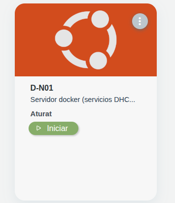 interfaz: enp2s0  
Crear el Usuario: bchecker/ Password: bchecker121.   
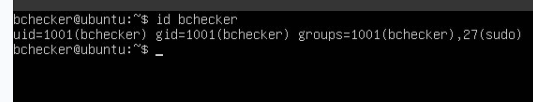

Asignacion de IP:  
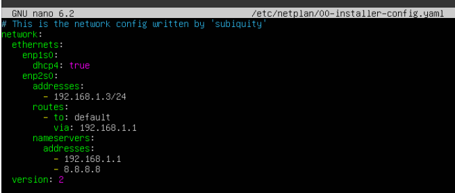

ping al router:  
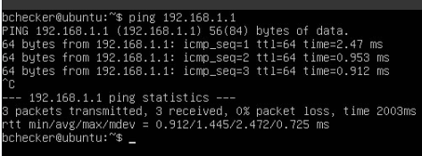
base de datos  
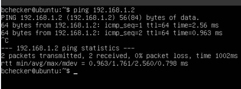

Instalar Docker Engine y Docker Compose:

Instalación y verificación del servicio Docker  
sudo apt update && sudo apt install \-y docker.io docker-compose  
sudo systemctl enable \--now docker  
sudo systemctl status docker  
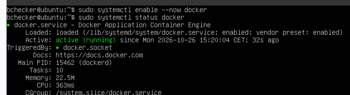

Comprobación: docker  \- \-version  
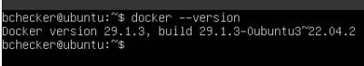

Crear la carpeta de trabajo:  
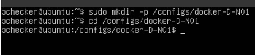

Crear el archivo principal que arrancará los dos contenedores en modo **host**:  
**docker-compose.yml**  
Se elige el modo **host** conecta la interfaz de red del contenedor directamente con la tarjeta de red física del servidor **D-N01**.

También fijamos una versión exacta de las imágenes de DHCP y DNS para que no haya errores a futuro, o llegamos a publicarlo o pasarlo a un compañero. En el de DHCP si o si hay que dejar **:latest** porque el creador de la imagen dhcp no hay ninguna versión como la de DNS y solo hay la de latest. Al subir los contenedores da error al instalar la imagen de **DNS** por lo que la única vía como el dhcp es poner **:latest.**  
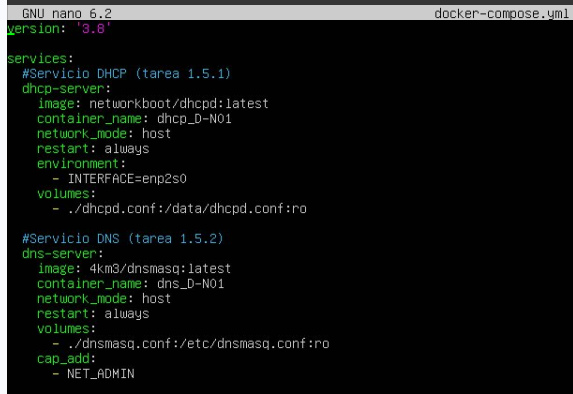

* **environment:** Pasa la variable INTERFACE=enp2s0 al contenedor para indicarle dónde escuchar.  
* **restart: always:** Reinicia el contenedor automáticamente si falla o si se reinicia la máquina virtual D-N01.  
* **volumes:** Enlaza el archivo de configuración del host dentro del contenedor (:ro \= solo lectura).  
* **cap\_add: NET\_ADMIN:** Da al contenedor DNS permisos de red avanzados sin darle acceso total de administrador (*root*).

Levantar los contenedores:  
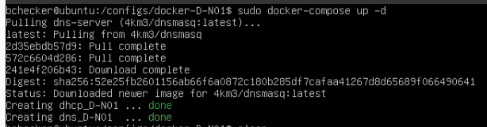

Comprobar que están activos y que no hay ningún fallo:   
No se logra ver bien por lo largo que es pero se ve que hay dos contenedores.   
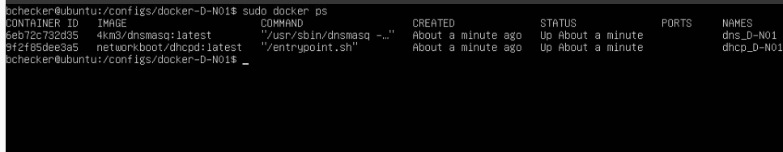

## 

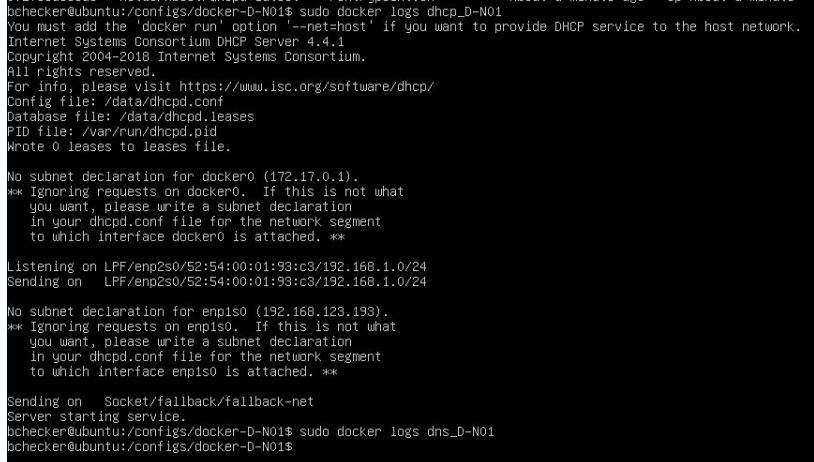

## 

## **Tarea 1.5.1: Despliegue del DHCP (D-N01) con Docker.**

**Rango de asignación dinámica:** 192.168.1.100 a 192.168.1.200  
**Puerta de enlace (Router):** 192.168.1.1  
**Servidor DNS:** 192.168.1.3 (IP de D-N01)  
**Máscara de red:** 255.255.255.0

Archivo de configuración dhcpd.conf:  
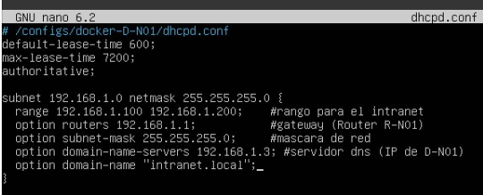

Solicitar una IP por DHCP: 58:6f  
sudo dhclient \-v enp2s0  
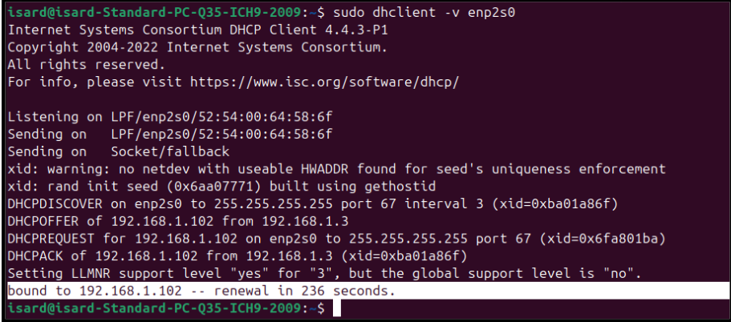

Verificar la asignación de IP: Debe recibir una IP dentro del rango 192.168.1.100 \- 192.168.1.200 y mostrar la gateway 192.168.1.1.  
ip a  
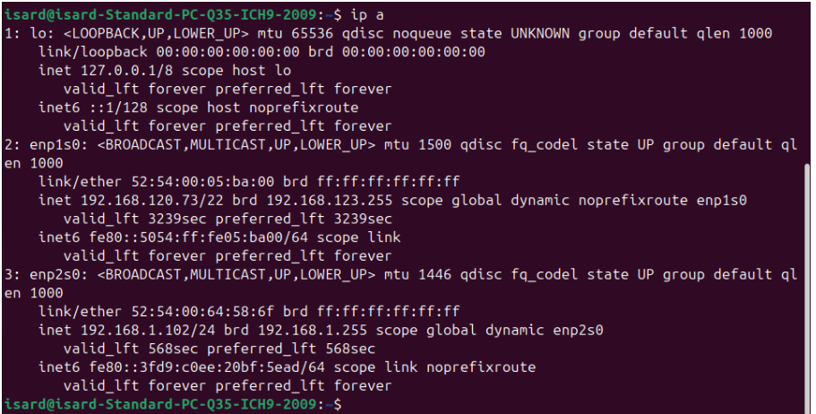

## 

## 

## 

## 

## 

## 

## 

## **Tarea 1.5.2: Despliegue del DNS (D-N01) con Docker.**

Archivo de configuración dnsmasq.conf  
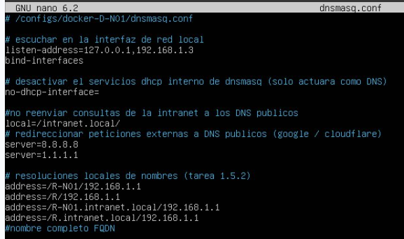

Probar la resolución del nombre R-N01:  
dig @192.168.1.3 R-N01 \+short (Resultado esperado: 192.168.1.1)  
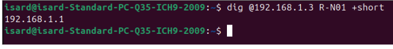
Probar la resolución del alias R:     
nslookup R 192.168.1.3 (Resultado esperado: Address: 192.168.1.1)  
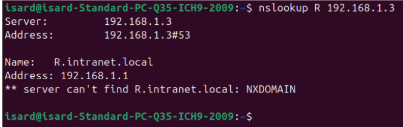
