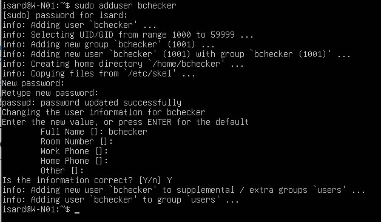

### Tarea 2.5.2: Configuración de Credenciales del Usuario bchecker W-N01

Creamos el usuario bchecker en el W-N01

| sudo adduser bchecker Password: bchecker123 |
| --- |

Agregamos el usuario bchecker al grupo sudo

| sudo usermod -aG sudo bchecker |
| --- |

