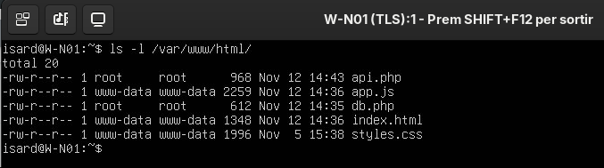
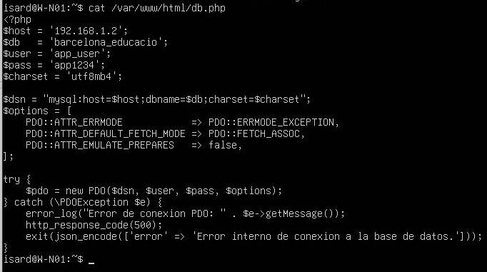
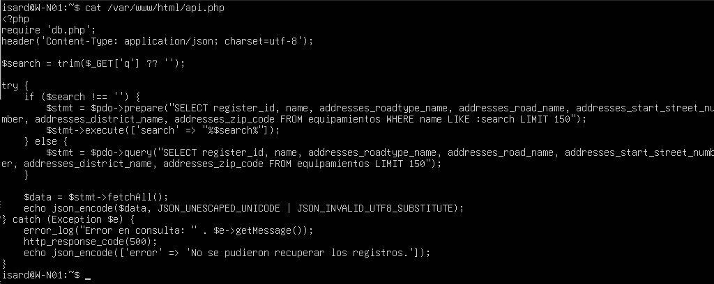
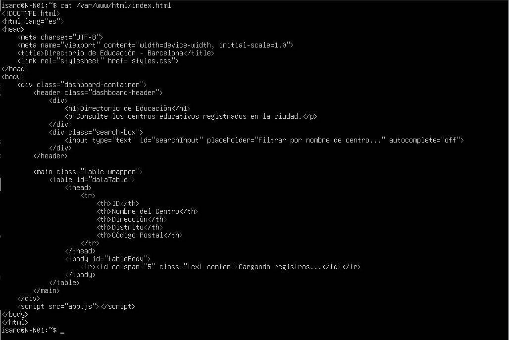
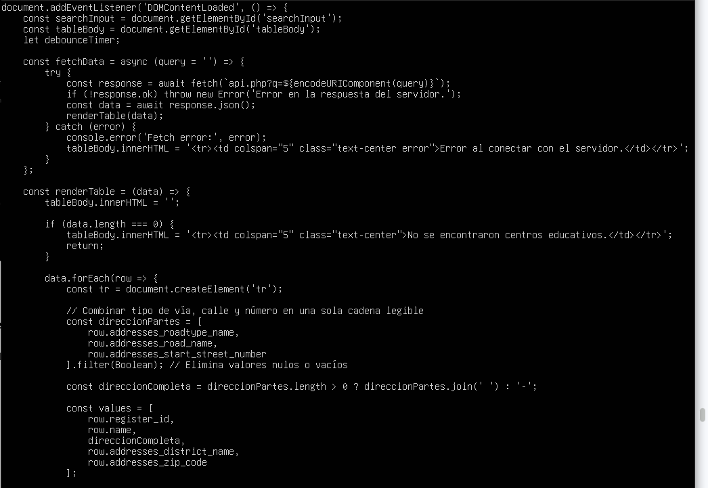
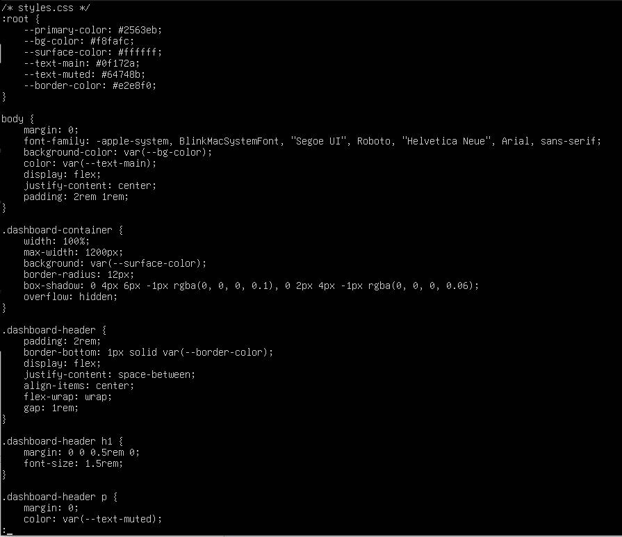
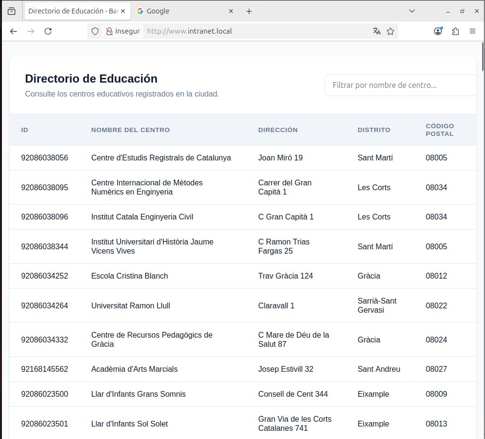

### Tarea 3.2: Desarrollo de la Aplicación Web de Consulta

Hemos desarrollado la app web que tiene diferentes archivos y funcionan juntamente

db.php: Gestiona la conexión segura hacia el servidor MySQL externo (192.168.1.2)

api.php: Recibe las peticiones del buscador, ejecuta las consultas preparadas sobre la tabla equipamientos y devuelve los registros en formato JSON.

index.html: Estructura HTML5 de la página (encabezado, cuadro de búsqueda y el esqueleto de la tabla con las 5 columnas).

app.js: Lógica del cliente; realiza las peticiones fetch a api.php, controla el buscador en tiempo real y rellena las filas de la tabla de forma segura (usando textContent para evitar XSS).

styles.css: Hoja de estilos con el diseño responsivo, tipografía y formato visual del panel y la tabla.

/var/www/html/db.php

/var/www/html/api.php

/var/www/html/index.html

/var/www/html/app.js

/var/www/html/styles.css

### Tarea 3.2.1: Desarrollo de la Aplicación Web de Consulta + Base de datos

Comprobar que la aplicación web de W-N01 conecta con la base de datos de B-N01.

