## Tarea 1.4: Despliegue y Configuración del Router (R-N01)

Configuramos el router con ambas interfaces

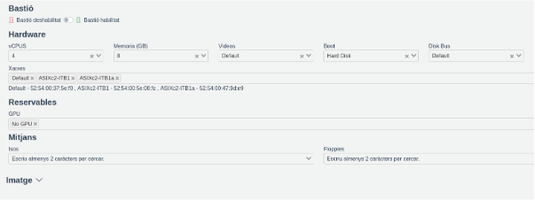

Configuramos la red y asignamos la ip para cada interfaz de red excepto una ya que es asignado por dhcp por isard

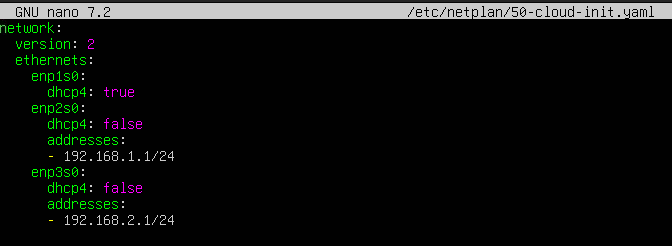

Probamos la conexión con los servidores de la intranet, en este caso con los Servidores D-N01 y B-N01

- B-N01 (192.168.1.2)

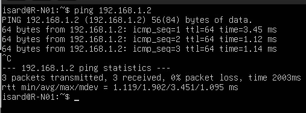

- D-N01(192.168.1.3)

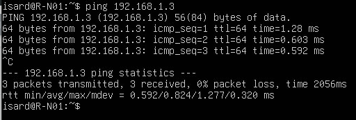

—

Creamos el fichero “/etc/sysctl.d/99-ipforward.conf” y agregamos la linea ”net.ipv4.ip_forward=1”, esto nos permitirá activar el reenvío de paquetes de ipv4

Una vez listo aplicamos la configuración sin necesidad de reiniciar:

| sudo sysctl -p /etc/sysctl.d/99-ipforward.conf |
| --- |

Luego verificamos si el reenvío quedo activado  
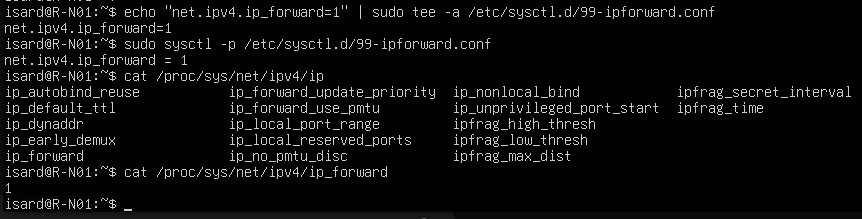

Una vez activado el reenvío de paquetes tambien tenemos que activar el enmascaramiento en la interfaz enp1s0 (que es la interfaz que tiene salida a internet), esto quiere decir que si la DMZ o la Intranet quieren salir a internet saldrán con la dirección ip de la interfaz enp1s0 y luego isard hará otro enmascaramiento-

Además instalamos el paquete iptables-persistent para que el enmascaramiento sea persistente y no se borre al reiniciar el router

| sudo iptables -t nat -A POSTROUTING -o enp1s0 -j MASQUERADE sudo apt update && sudo apt install iptables-persistent -y |
| --- |

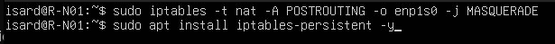

Comprobación de la conexión de la Intranet al DMZ

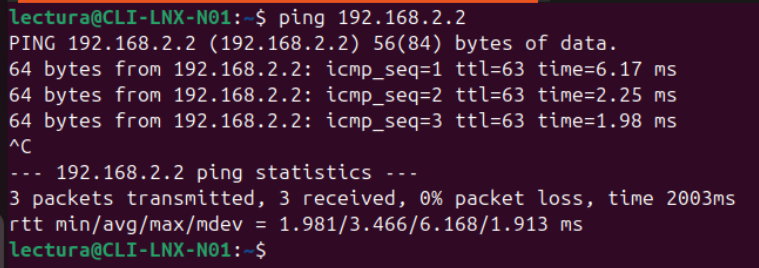

Luego de ello agregaremos funciones como Port Knocking o noqueo de puertos, el Port Knocking o golpeo de puertos es un mecanismo de seguridad que mantiene el puerto de administración SSH (puerto 22) completamente cerrado e invisible a escaneos externos. El puerto solo se abre temporalmente para una dirección IP específica cuando esta envía una secuencia secreta de paquetes TCP a varios puertos en un orden determinado, por ejemplo, enviar un paquete al puerto 7000, luego al 8000 y finalmente al 9000.

Instalamos el servicio knockd

| sudo apt install knockd -y |
| --- |

Luego de ello, editamos el archivo de configuración y lo dejamos con la siguiente estructura

| sudo nano /etc/knockd.conf |
| --- |

| 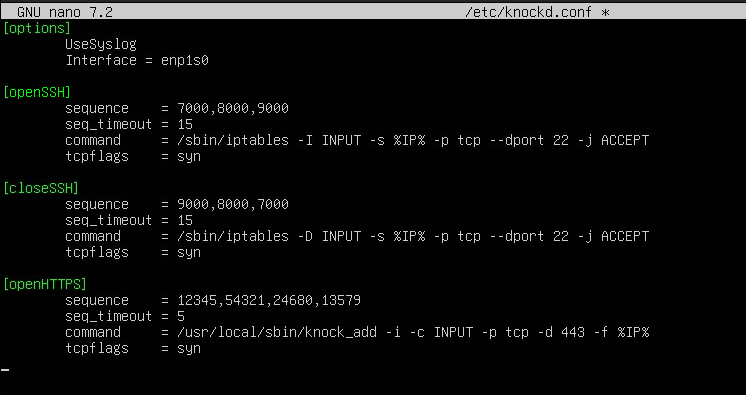 |
| --- |

Explicación de cada sección y parámetro:

[options]:

UseSyslog: Envía los registros de actividad al sistema de logs del SO (/var/log/syslog), permitiendo auditar quién ha "golpeado" los puertos

Interface = enp1s0: Especifica la tarjeta de red que knockd estará escuchando (en este caso, la interfaz WAN enp1s0 de IsardVDI)

[openSSH]: Nombre de la regla personalizada

sequence = 7000,8000,9000: La secuencia exacta de puertos a los que hay que enviar tráfico de forma consecutiva para activar la regla

seq_timeout = 15: El tiempo máximo (en segundos) que tiene el cliente para completar la secuencia de los 3 puertos

tcpflags = syn: Exige que las peticiones enviadas a los puertos sean paquetes de inicio de conexión TCP (SYN)

command: La orden de iptables que ejecuta knockd cuando detecta la secuencia correcta:

-I INPUT: Inserta la regla al principio de la cadena de entrada del firewall

-s %IP%: Reemplaza automáticamente %IP% por la dirección IP del cliente que realizó el golpeo

-p tcp --dport 22: Especifica que la regla aplica al protocolo TCP en el puerto 22 (SSH)

-j ACCEPT: Permite el paso del tráfico

[CloseSSH]: Regla de cierre

sequence = 9000,8000,7000: Golpes en orden inverso 9000-8000-7000 para cerrar

seq_timeout = 15: Tiempo límite de 15 segundos para enviar los 3 golpes.

command = /sbin/iptables -D INPUT -s %IP% -p tcp --dport 22 -j ACCEPT: Elimina (-D) la regla de permiso del firewall, bloqueando de nuevo el puerto 22 para esa IP.

Por último activamos el servicio ya que por defecto viene desactivado

| sudo nano /etc/default/knockd sudo systemctl restart knockd sudo systemctl status knockd |
| --- |

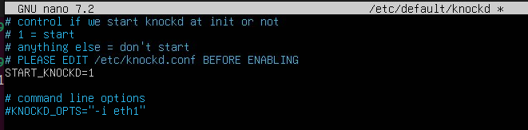

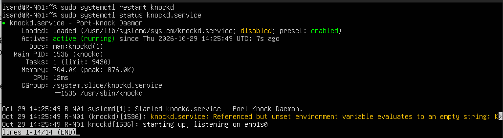

Y además bloqueamos el puerto 22, ya que por defecto está abierto y si está abierto el port knocking no haría su función

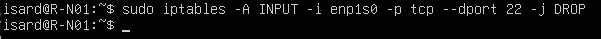

-i enp1s0: Aplica la regla únicamente a la interface enp1s0.

--dport 22: Especifica el puerto de destino

-j DROP: Define la acción descartar/bloquear el paquete en silencio
