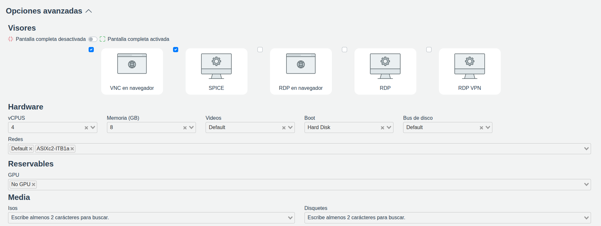
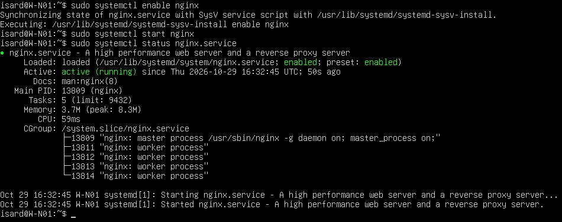
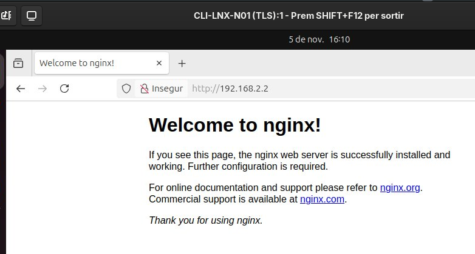
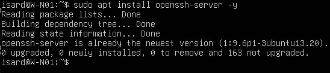
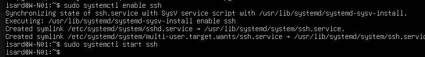
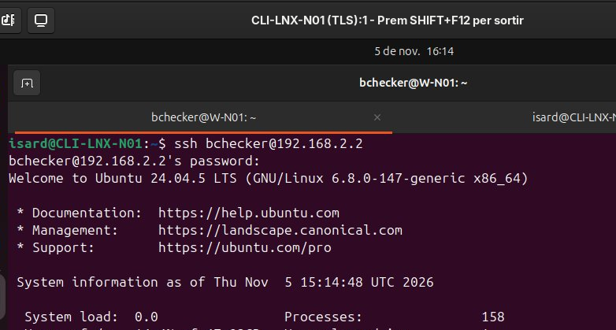
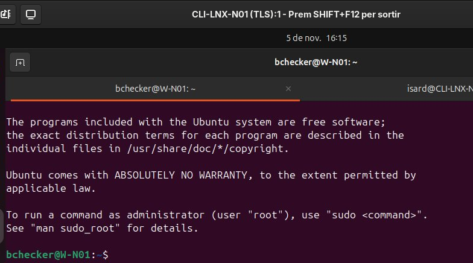
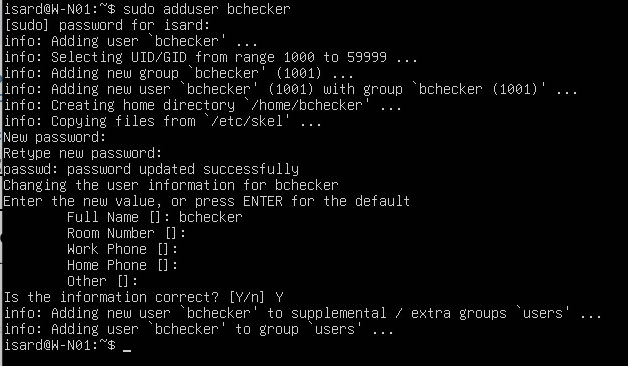
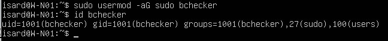

## Tarea 2.1: Despliegue del Servidor Web (W-N01)

Instalar y configurar el Servidor Web W-N06 en la red DMZ.

Desplegamos el servidor web con la interfaz correspondiente a la DMZ (ITB1a)

Para el servicio web usaremos NGINX, para instalarlo hay que usar los siguientes comandos

| sudo systemctl enable nginx sudo systemctl start nginx sudo systemctl status nginx |
| --- |

Comprobación

Desde el cliente linux CLI-LNX-01

### Tarea 2.1.1: Despliegue SSH al Servidor Web (W-N01)

Asegurar que el acceso SSH esté habilitado para administración en el servidor web W-N01.

Instalamos el servicio openssh server y habilitamos el servicio

| sudo apt install openssh-server -y |
| --- |

| sudo systemctl enable ssh sudo systemctl start ssh |
| --- |

Comprobación

### Tarea 2.5.2: Configuración de Credenciales del Usuario bchecker W-N01

Creamos el usuario bchecker en el W-N01

| sudo adduser bchecker Password: bchecker123 |
| --- |

Agregamos el usuario bchecker al grupo sudo

| sudo usermod -aG sudo bchecker |
| --- |

